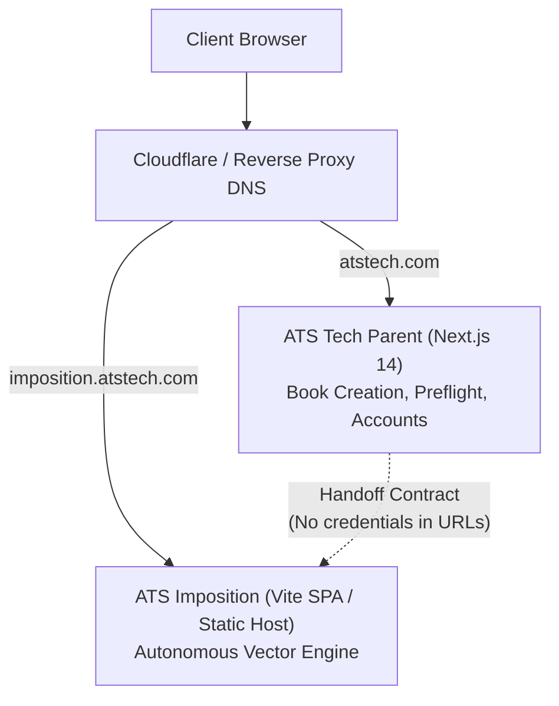

# ATS Imposition (MyDraw) Submodule Integration Guide

> [!IMPORTANT]
> **Submodule Invariant**: The `imposition/` directory contains an independent Git submodule tracking `https://github.com/idea2output/atsimpose.git` on branch `imposition-only`. Never modify, refactor, reorganize, or format source files inside `imposition/` from the parent ATS Tech workspace.

---

## 1. Architecture Overview

ATS Tech integrates **ATS Imposition** (MyDraw / ArtCraft) physically within the repository under `imposition/` while preserving complete isolation:

```
ATS Tech Parent Repository (ATSEasyBook)
├── .gitmodules                 # Submodule pointer (branch: imposition-only)
├── imposition/                 # Git Submodule (independent Git history, lockfile, dependencies)
│   ├── package.json            # Independent dependencies (React 18, Vite 5, Tailwind v4, pdf-lib, pdfjs-dist)
│   ├── vite.config.ts          # Independent Vite configuration
│   └── src/                    # Completely untouched MyDraw source
├── src/                        # ATS EasyBook, Preflight & Public Platform (Next.js 14)
├── docs/                       # Shared handoff specifications & architecture contracts
└── package.json                # EasyBook dependencies
```

### Key Isolation Guarantees:
- **Zero Shared Node Modules**: ATS EasyBook (`Next.js 14`) and ATS Imposition (`Vite 5`) use independent `node_modules` trees and separate lockfiles.
- **Zero In-Tree File Leakage**: No MyDraw components, utilities, or types are placed in `src/`, `app/`, `public/`, or `components/` of ATS EasyBook.
- **Dedicated Subdomain Readiness**: MyDraw uses root-relative asset URLs (`/assets/...`) which require root-level path resolution. Deploying ATS Imposition to a dedicated subdomain (e.g. `imposition.atstech.com`) ensures complete asset and web-worker functionality without modifying any Vite configurations.

---

## 2. Initial Setup & Cloning

When cloning ATS Tech on a new developer machine or CI server:

```bash
# Clone the parent repository with all submodules
git clone --recurse-submodules https://github.com/idea2output/ATSEasyBook.git

# Or if cloned without --recurse-submodules:
git submodule update --init --recursive
```

---

## 3. Running Applications Independently

### A. Run Integrated ATS Tech & Impose (Same Host / Port 3008)
```bash
# From workspace root - builds imposition and starts integrated platform
npm install
npm run dev:impose-integrated
# Access ATS Tech at http://localhost:3008/
# Access ATS Impose at http://localhost:3008/Impose/
```

### B. Building & Running in Production
```bash
# Parent automated build automatically compiles Imposition and Next.js
npm run build
npm start -- -p 3008
```

---

## 4. Building & Testing Commands

The integrated platform provides single-command parent workflows:

| Workflow | Command | Scope |
| :--- | :--- | :--- |
| **Integrated Platform Dev** | `npm run dev:impose-integrated` | Builds Imposition & starts Next.js on port 3008 |
| **Build Imposition Submodule** | `npm run build:impose` | Compiles Imposition Vite dist output to `imposition/dist` |
| **Build All Production** | `npm run build` | Builds Imposition then compiles Next.js production build |
| **Test All Platforms** | `npm run test:all` | Runs 205 parent tests + 271 Imposition submodule tests |
| **Imposition Submodule Only** | `npm --prefix imposition test` | Runs 19 submodule Vitest suites independently |

---

## 5. Environment & Routing Configuration

ATS Impose mounts seamlessly under `/Impose/` on the same host:
- Local development: `http://localhost:3008/Impose/`
- Production: `https://atstech.com/Impose/`

No separate localhost port (such as 5173) is required or opened. All navigation and job handoffs occur within the same browser tab without iframe embedding or popup redirects.

---

## 6. How to Update / Pin a Newer MyDraw Commit

To update the submodule when a new commit is released in `atsimpose`:

```bash
# 1. Enter the submodule directory
cd imposition

# 2. Fetch latest changes from remote
git fetch origin
git checkout imposition-only
git pull origin imposition-only

# 3. Verify clean build and tests inside imposition
npm test
npm run build

# 4. Return to parent repository and stage the updated commit pointer
cd ..
git add imposition
git commit -m "chore(imposition): pin ATS Imposition submodule to commit <NEW_SHA>"
```

---

## 7. Rollback Procedure

If a pinned commit introduces issues, roll back to the previously verified commit:

```bash
# 1. Check out verified commit inside imposition
cd imposition
git checkout 6d176b286d0a58917495f512f1d3d910962a6b3c

# 2. Return to parent and stage the rollback pointer
cd ..
git add imposition
git commit -m "revert(imposition): roll back ATS Imposition submodule to verified commit 6d176b2"
```

---

## 8. Recommended Production Deployment Topology



- **Domain Isolation**: Protect `imposition.atstech.com` using the organization's reverse-proxy gateway (OAuth2-Proxy, Cloudflare Access, or HTTP Bearer token verification).
- **Security Boundary**: No sensitive authentication credentials, passwords, or session secrets are passed through query parameters.
